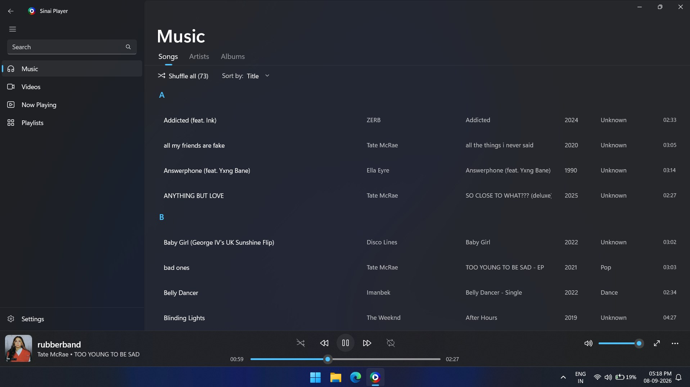
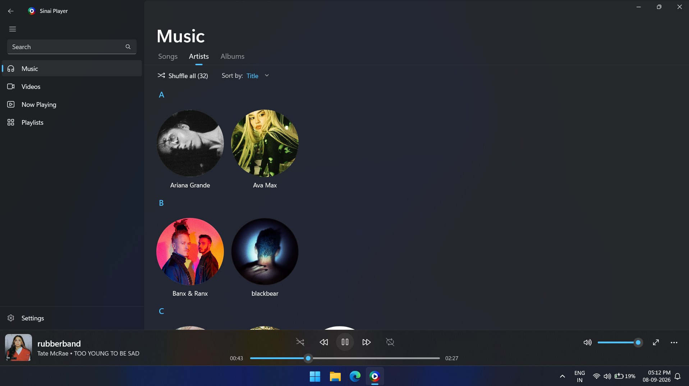
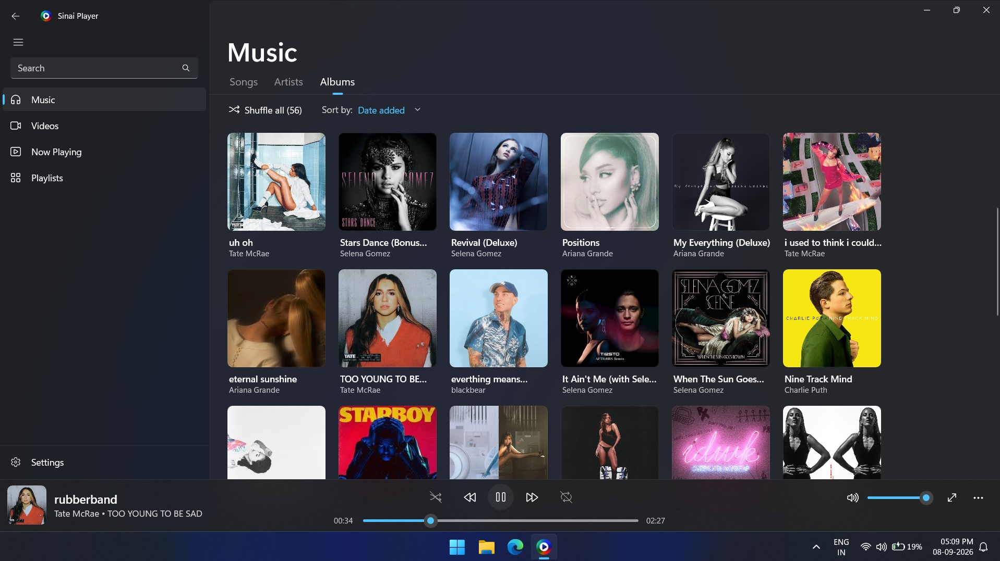
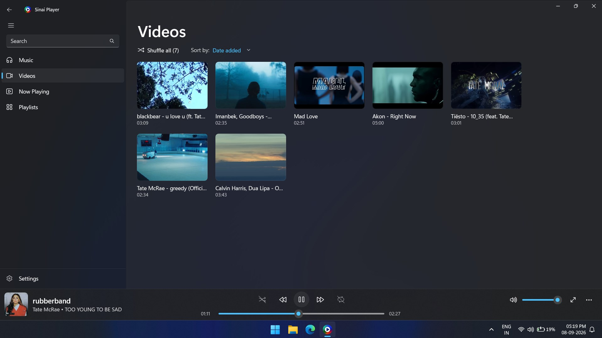
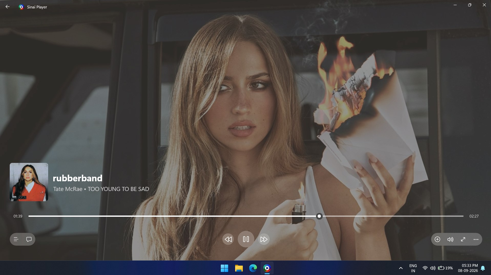
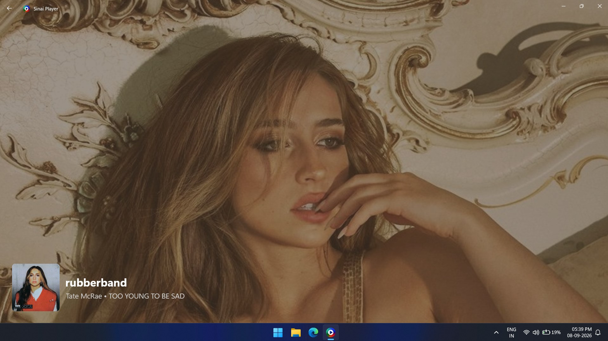
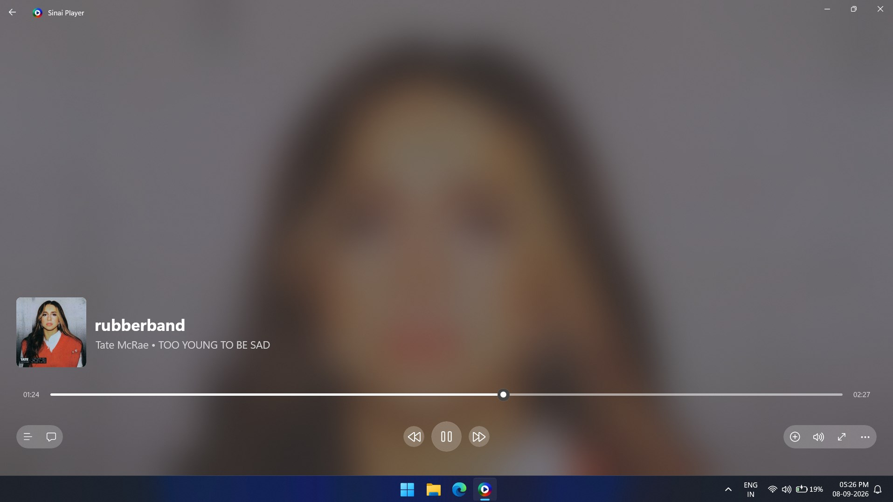
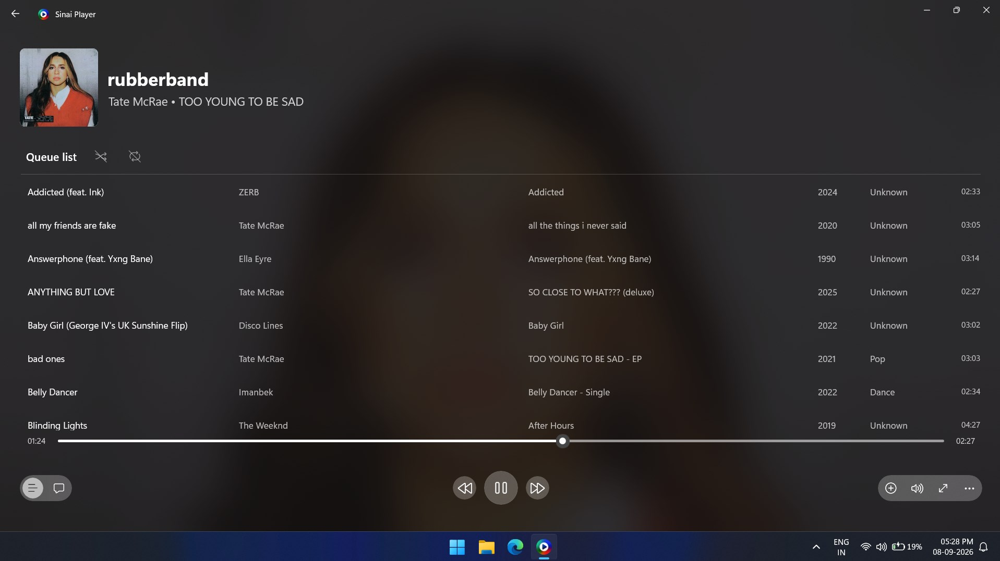

# Sinai Player

A modern, immersive media player for Windows built for locally stored music and videos, offering broad media format support and rich library details.

## 📸 Screenshots

#### Music
| Songs |
| :---: |
|  |

| Artists |
| :---: |
|  |

| Albums |
| :---: |
|  |

| Artist details |
| :---: |
|  |

| Album details |
| :---: |
|  |

#### Videos
| All videos |
| :---: |
|  |

#### Playlists
| All Playlists |
| :---: |
|  |

| Playlist details |
| :---: |
|  |

#### Now Playing
| Artist slideshow style|
| :---: |
|  |

| Artist slideshow style (after controls faded) |
| :---: |
|  |

| Default style |
| :---: |
|  |

| Queue |
| :---: |
|  |

## 💎 Features

- **Wide Audio and Video Format Support:** Play local music and video files across formats.
- **High-Quality Lossless Audio Playback:** Built for clear, high-fidelity local listening.
- **Immersive Now Playing Experience:** Focused playback view with a modern interface.
- **Queue Management:** Organize and control upcoming tracks and media.
- **Rich Metadata & Artwork:** View album artwork, artist images, artist biographies, and detailed metadata.
- **File Explorer & Removable Storage Support:** Open media smoothly and access files on external or removable storage.

## ⚠️ System Requirements

- **Operating System:** Windows 10 version 17763.0 or higher
- **Supported Devices:** PC, Mobile, Xbox console, Surface Hub, HoloLens
- **Memory:** 500 MB RAM (minimum)

## 🙋‍♂️ FAQ

**Can I stream and download songs like Spotify?**

No, you cannot stream or download songs. This app only plays songs from the folders you've selected from your device locally

**Does it play my iTunes purchased music?**

Yes, iTunes purchased music will play in full quality. But you must download the song first and specify the media folder where your itunes songs gets downloaded in settings.

**Is this some kind of video player like VLC or Windows Media Player?**

Yes it is, Unlike those apps this app has more functionality and features with updated and modern UI compared with them. And it plays both video and audio files supporting wide range of formats like VLC and has the modern design than the windows media player

## 🙏 Follow us

#### App

  
  

#### Developer & Founder

  
  

We're looking for more contributors and maintainers!
If you'd like to be a maintainer, please DM us on any of these social platforms

In any case, if you find or notice any bugs please report them by creating an issue or by contacting us via our [support email](business.rohithsinai@gmail.com). If you have any feature suggestions, please create an issue with detailed information or by contacting us via [email](business.rohithsinai@gmail.com) or from any one of these social platforms